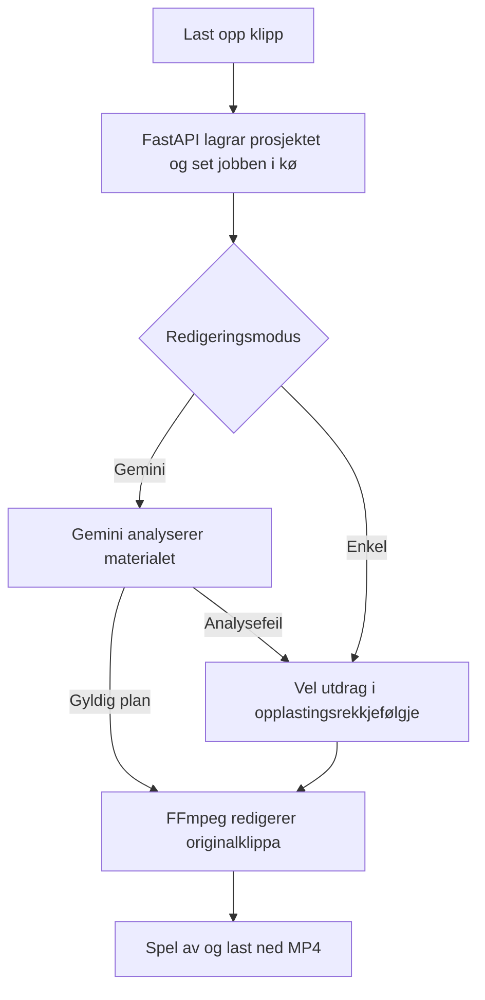

# Klipp – AI-videoredigering

Klipp er eit skuleprosjekt der du lastar opp videoklipp, vel korleis dei skal redigerast og får ei MP4-fil du kan spele av og laste ned. Målet var å lage ein enkel arbeidsflyt frå råmateriale til ferdig video. Codex vart brukt som hjelp til å utvikle, feilsøkje og teste koden. Gemini er AI-tenesta i sjølve appen. Rettleiinga gjeld denne kodeversjonen. Nettdemoen på Render viser den sist publiserte versjonen.

I **Enkel redigering** blir utdrag frå klippa sette saman i opplastingsrekkjefølgje. Med **AI-redigering med Gemini** kan du skildre videoen du ønskjer, og Gemini foreslår kva delar av klippa som passar og kva rekkjefølgje dei skal spelast i. Begge modusane kan eksportere med eigen tekst, valt biletformat og lyd frå kjeldeklippa.

## Prøv Klipp

1. Gå til **Mine prosjekt**, opprett eit prosjekt og last opp to korte videoklipp.
2. Vel lengd og biletformat. Bruk til dømes **9:16** for ståande klipp.
3. Vel redigeringsmodus. Med Gemini kan du starte med ein mal som **Sterk opning**, tilpasse instruksjonen og samtykkje til analysen.
4. Skriv eventuelt ein tittel i **Tekst i videoen**. Opptil 60 teikn kan visast dei første tre sekunda, dei siste tre sekunda eller gjennom heile videoen. **Korte tekstar på klippa** let Gemini foreslå eigne klipptekstar.
5. Trykk **Lag video**. Spel av resultatet, opne **Sjå klippeplan** og last ned MP4-fila.

Etter eksport kan du lagre kanal og tidspunkt i ein publiseringsplan. Planen blir verande i Klipp.

## Finn fram i VS Code

| Fil eller mappe | Oppgåve |
| --- | --- |
| [index.html](index.html) | Grunnstruktur, meny og innlasting av appen. |
| [styles.css](styles.css) | Fargar, layout og mobiltilpassing. |
| [app.js](app.js) | Skjema, opplasting, API-kall, jobbstatus og resultat i nettlesaren. |
| [app/main.py](app/main.py) | FastAPI-endepunkt, SQLite-lagring og køen som køyrer videojobbar. |
| [app/media.py](app/media.py) og [app/presentation.py](app/presentation.py) | Mediekontroll, klipping, format, lyd, videotitlar og tekst under FFmpeg-eksporten. |
| [app/gemini.py](app/gemini.py) og [app/cut_plan.py](app/cut_plan.py) | Analyse hos Google og kontroll av den føreslåtte klippeplanen. |
| [app/schemas.py](app/schemas.py), [app/hosting.py](app/hosting.py) og [app/narration.py](app/narration.py) | Inndatakontroll, passordvern for nettdemoen og lokal forteljarstemme på Windows. |
| [requirements.txt](requirements.txt) | Python-pakkane som må installerast. |
| [Dockerfile](Dockerfile) og [render.yaml](render.yaml) | Oppskrifta for å byggje og køyre appen på Render. |
| [tests/](tests/) | Testar av API, videoeksport, Gemini-flyten og grensesnittet. |

Den lokale `data/`-mappa inneheld `app.db`, kjeldeklipp i `uploads/` og eksportar i `outputs/`. Ta vare på henne dersom du skal flytte prosjekt og videoar til ein annan PC. `.env` inneheld lokale innstillingar og eventuelt API-nøkkelen din. Desse filene er utanfor Git. Malen for innstillingane ligg i [.env.example](.env.example).

VS Code-visinga skjuler det virtuelle Python-miljøet og genererte cachefiler. Python lagar cachefilene på nytt ved behov.

## Korleis videoen blir laga



**Opplasting og kø.** Serveren sjekkar filtype og storleik, og brukar ffprobe til å lese videoformat og lengd. Han lagrar klippa under genererte filnamn og held styr på prosjektet i SQLite. Éin bakgrunnsarbeidar tek éin jobb om gongen, slik at nettsida kan vise reell framdrift medan videoen blir behandla.

**Klippeplan.** Ved enkel redigering blir lengda fordelt proporsjonalt mellom klippa. I Gemini-modus får appen eit strukturert svar med klipp-ID, starttid, sluttid og rekkjefølgje. Serveren sjekkar at alle utdraga kjem frå prosjektet, ligg innanfor kjeldefilene og passar den valde lengda. Ved analysefeil brukar jobben enkel redigering og merkar resultatet **Reserve · enkel redigering utan AI**.

**Eksport.** FFmpeg klipper originalfilene, tilpassar biletet, set saman lyd og video og legg eventuell tekst på biletet. Eksporten brukar H.264 og AAC i MP4 med 24 bilete i sekundet. Du kan velje 1280 × 720, 720 × 1280 eller 720 × 720. Redigeringsstilen styrer om klippa får korte toningar eller direkte overgangar.

**Gemini lokalt og på Render.** Lokalt får Gemini vanlegvis små videokopiar med lyd frå korte prosjekt. Ved behov brukar appen Google si filteneste og prøver å slette analysefilene etterpå. På Render får Gemini utvalde stillbilete med tidsmerke. Korte prosjekt med opptil fire klipp og eitt minutt med kjeldemateriale kan sende fem bilete per klipp. Løysinga bruker mindre data, men Gemini kan oversjå det som skjer mellom bileta og får berre bilete til analysen på Render. FFmpeg brukar framleis lyd frå originalane ved eksport.

FastAPI tener både nettsida og API-et. Vanleg HTML, CSS og JavaScript kan lastast direkte i nettlesaren, og SQLite lagrar prosjektdata i ei lokal fil. Det gjer det mogleg å starte heile appen med éin serverkommando.

## Start lokalt

Du treng [Git](https://git-scm.com/downloads), [VS Code](https://code.visualstudio.com/), [Python 3.11 eller nyare](https://www.python.org/downloads/) og [FFmpeg med ffprobe](https://ffmpeg.org/download.html). Opne prosjektmappa i VS Code. Dersom du manglar mappa, kan du hente henne i PowerShell.

```powershell
git clone https://github.com/e-liaber2-crypto/Ai-proskjekt.git
cd Ai-proskjekt
code .
```

På Windows kan du installere FFmpeg med `winget install --id Gyan.FFmpeg --exact`. Opne ein ny terminal etterpå, og sjekk `ffmpeg -version` og `ffprobe -version`. Køyr desse kommandoane frå prosjektmappa første gongen.

```powershell
py -3 -m venv .venv
.\.venv\Scripts\python.exe -m pip install -r requirements.txt
if (!(Test-Path .env)) { Copy-Item .env.example .env }
```

Start deretter heile appen med Uvicorn. API-et og nettsida blir serverte frå same adresse.

```powershell
.\.venv\Scripts\python.exe -m uvicorn app.main:app --host 127.0.0.1 --port 8000
```

Opne [Klipp lokalt](http://127.0.0.1:8000) og stopp serveren med `Ctrl+C`. Bruk same startkommando ved seinare oppstart. På macOS og Linux lagar du miljøet med `python3 -m venv .venv` og brukar `.venv/bin/python` i staden for Windows-stien til Python.

### Slik slår du på Gemini

Set `GEMINI_API_KEY` i lokal `.env` eller i miljøet som startar serveren. Start serveren på nytt og vel Gemini i arbeidsflata. På Render set du variabelen under **Environment**. Python-serveren brukar nøkkelen. Ved kvar Gemini-jobb må du samtykkje til at analysebilete eller videokopiar blir sende til Google. Enkel redigering fungerer utan nøkkel. [Hent Gemini-nøkkel i Google AI Studio](https://aistudio.google.com/apikey)

| Innstilling | Bruk |
| --- | --- |
| `GEMINI_MODEL` | Vel Gemini-modell. Standard i prosjektet er `gemini-3.8-flash`. Tilgang og kvote kjem frå Google-prosjektet. |
| `DATA_DIR` | Endrar plasseringa til databasen og videoane. Lokalt er standard `data/`. |
| `FFMPEG_THREADS` | Styrer talet på trådar FFmpeg får bruke. Standard er 2 lokalt og 1 på Render. |
| `FFMPEG_BIN` og `FFPROBE_BIN` | Full sti til programma dersom dei ligg utanfor `PATH`. |

## Render

Nettdemoen blir bygd frå GitHub med Docker og køyrer som ei delt, passordverna teneste for elev og lærar. Opne [Klipp på Render](https://ai-proskjekt-demo.onrender.com). Brukarnamnet er `laerar`, og passordet er verdien til `DEMO_PASSWORD` under **Environment** på Render. Appen krev eit passord med minst 16 teikn ved offentleg hosting.

- **Første oppsett.** Vel **New → Blueprint** på Render og kople til dette GitHub-prosjektet. `render.yaml` set opp ei Docker-teneste på Free og genererer demopassordet.
- **Oppdatering.** Render-demoen følgjer `main`. Innstillinga `checksPass` ventar på grøne GitHub-kontrollar før publisering. Ei manuelt oppretta teneste brukar **Docker**, **After CI Checks Pass** og `/healthz` som helsesjekk. La Dockerfile velje startkommandoen og bruke Render sin `PORT`.
- **Kontroll.** `/healthz` sjekkar SQLite, videoarbeidaren, FFmpeg og ffprobe. Når tenesta er **Live**, prøv å laste opp og eksportere to korte klipp for å sjekke heile arbeidsflyten.

På **Render Free** ligg dataa i mellombels lagring. Prosjekt, opplasta filer og eksportar kan forsvinne ved dvale, omstart og ny deploy. Last ned ferdige videoar før ei oppdatering. For vedvarande lagring på ein betalt plan må disken monterast og `DATA_DIR` peike til han før `PERSISTENT_STORAGE=true` blir sett. Ved annan offentleg hosting set du `PUBLIC_HOST` til vertsnamnet og brukar HTTPS. [Render Free](https://render.com/docs/free) · [Render Blueprint](https://render.com/docs/blueprint-spec)

## Testing og erfaringar

Eit problem under utviklinga var at analysen på Render kunne nå tidsgrensa eller få HTTP 503 frå Google. Klipp tek derfor ut tidsmerkte bilete på Render. Appen prøver igjen ved HTTP 503 så lenge det er tid att, og kan bruke ein lettare Gemini-modell. Ved analysefeil får brukaren eit tydeleg merkt reserveresultat. Det gjorde det mogleg å få ut ein video sjølv når analysen gjekk gale.

| Test | Kva han kontrollerer |
| --- | --- |
| To klipp med og utan lyd | Ekte MP4 i tre biletformat, med begge kjeldene og eit lydspor. |
| Eigen tekst | Synleg i nedlasta video på dei valde tidspunkta, også når klippet skiftar. |
| Simulert Gemini-svar og tidsavbrot | Rett klipprekkjefølgje, synlege tekstar og eksport med reserve når analysen feilar. |
| Docker på GitHub Actions | Oppstart med Render-port, krav om passord og fungerande helsesjekk. |

Testane brukar syntetiske klipp og simulerte Google-svar. Dei kontrollerer at appflyten fungerer, medan eit manuelt forsøk i demoen også testar Google-tilgangen og dei faktiske klippevala. Bruk to korte klipp, noter om jobben enda i **Gemini** eller **Reserve**, og kontroller at begge finst i avspelinga og nedlastinga.

Køyr frå prosjektmappa. Node.js trengst for JavaScript-testane.

```powershell
.\.venv\Scripts\python.exe -m unittest discover -s tests -v
node --check app.js
node --test tests/*.test.cjs
```

## Grenser og vidare arbeid

Klipp tek imot MP4, MOV, MKV og WebM. Kvar fil kan vere opptil 200 MiB og 30 minutt lang. Eit prosjekt kan ha 12 klipp. Ein Gemini-jobb kan analysere opptil 10 klipp med 30 minutt samla kjeldelengd. Ønskt eksportlengd er 1 sekund til 10 minutt og må passe kjeldematerialet. Appen har ei samla lagringsgrense på 2 GiB.

Rangeringsgrafikk og opningstitlar kan leggjast inn via Gemini-instruksjonen. Forteljarstemme krev ei norsk Windows-stemme lokalt. Automatisk transkripsjon, musikk, betaling og publisering til sosiale medium er moglege utvidingar. Abonnementsplanane viser døme på korleis tenesta kan fungere seinare.

## Tekniske kjelder

- [FastAPI](https://fastapi.tiangolo.com/) · [SQLite](https://sqlite.org/docs.html) · [FFmpeg](https://ffmpeg.org/documentation.html)
- [Google GenAI SDK for Python](https://github.com/googleapis/python-genai) · [Gemini-videoanalyse](https://aistudio.google.com/docs/video-understanding)
- [Render Blueprint](https://render.com/docs/blueprint-spec) · [VS Code-innstillingar for prosjekt](https://code.visualstudio.com/docs/configure/settings)
